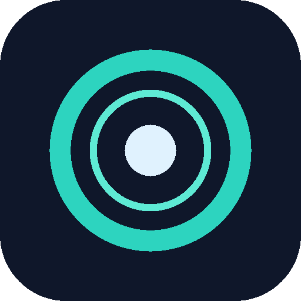

<p align="center">
  
</p>

<h1 align="center">Nova Dev</h1>

<p align="center">
  <b>Lazy-but-complete developer mode for Claude Code and Codex.</b><br>
  Writes the smallest change that fully works, checks every caller, adds one test for new logic,<br>
  and keeps token use in check.
</p>

---

## Why

- **Less code, same result.** Reuses what the codebase already has before writing anything new.
- **Nothing breaks quietly.** Every caller, test and fixture a change touches is checked.
- **Honest replies.** Every answer ends with what was skipped and what risk remains.
- **Measured, not guessed.** Token use and cache hits come from your own transcripts.
- **Private by default.** Nothing leaves your machine unless you set a webhook.

## Install

**Claude Code**

```
/plugin marketplace add C:\claudeobsidainai\nova-dev
/plugin install nova-dev@nova-dev
```

**Codex**

```
codex plugin marketplace add C:\claudeobsidainai\nova-dev
codex plugin add nova-dev@nova-dev
```

Then run `codex`, open `/hooks`, and trust nova-dev's two hooks.

Requirements: Python 3 (`py -3` or `python` on PATH) and Node.js (Codex needs it anyway).

## Choose a level

nova-dev has **no default level**. Nothing is active until you choose one:

| Level | What it does |
|-------|--------------|
| `nova dev lite` | Builds what you asked. Names the smaller option and lets you pick. |
| `nova dev full` | The complete rules. Smallest change, every caller checked, one test for new logic. |
| `nova dev ultra` | Like full, and pushes back on any part the need does not justify. |
| `nova dev off` | Nothing active in this folder. |

Set it per project with `.claude/nova-dev.json`, or run `nova-dev-init`, which asks you.

## What you get

| Area | Features |
|------|----------|
| **Coding rules** | Smallest-change ladder, caller checks, test-for-logic rule, Skipped / Risk line |
| **Review** | `nova-dev-review`, `review-fast`, whole-repo `nova-dev-audit`, security and perf passes |
| **Tests** | `nova dev test` runs your tests and feeds the Stop gate; `testcheck` flags untested logic |
| **Context** | Read guard, Bash guard, context warning, auto-compact (opt-in), snapshot and handoff restore |
| **Measure** | `stats` (tokens and cache hit rate), per-project totals, `contexthist`, `hogs` |
| **Band** | Session ledger, HTML board, Markdown export, optional webhook |
| **Find and explain** | `find` past prompts, `callers`, `outline`, `annotate` |
| **Safety** | Secret redaction, secret scan, self-audit (`seccheck`), owner-only files |
| **Agents** | `nova-scout` (locate), `nova-reader` (digest), `nova-runner` (tests), with model routing |

Run `python -I scripts/nd.py help` or see `skills/nova-dev-help` for the full list.

## Commands

In chat, type the level and status commands: `nova dev lite`, `nova dev full`, `nova dev ultra`, `nova dev off`, `nova dev status`.

Everything else runs from the CLI, `scripts/nd.py`:

```
python -I scripts/nd.py test              # run the project's tests, save the result for the Stop gate
python -I scripts/nd.py review            # compressed diff + secrets + test check
python -I scripts/nd.py find <words>      # search your past prompts
python -I scripts/nd.py stats 30 --by-project
python -I scripts/nd.py help              # every command
```

## Settings

Set them in `~/.config/nova-dev/config.json`, or as environment variables (which win).

| Key | Default | What it does |
|-----|---------|--------------|
| `level` | unset | The level you choose |
| `context_warn` | 150000 | Warn once when context passes this many tokens |
| `window` | 200000 | Context window size, for percentages |
| `autocompact` | false | Pause prompts at 55% of the window until you run `/compact` |
| `ledger` | true | Record each session in the band ledger |
| `webhook_url` | empty | https address that receives each session row (off by default) |
| `webhook_token` | empty | Sent as a bearer token. Environment variable only |
| `send_names` | false | Include task names (prompt text) in the webhook |
| `big_read` | 0 | Block whole-file reads longer than this many lines (0 = off) |

## Privacy and security

- Transcripts are read locally. Nothing is sent anywhere unless you set `webhook_url`.
- Secret-looking text is redacted before it reaches the ledger, the snapshot or a review.
- Files are written owner-only where the OS allows it.
- The plugin audits its own code: `nova dev seccheck`.

Details, including the known limits, are in [SECURITY.md](SECURITY.md).

## How it works

| Hook | When | What |
|------|------|------|
| Session start | Session begins | Adds the rules for your level |
| Prompt | You send a message | Level commands, context warning, optional auto-compact |
| Read | Before and after a file read | Blocks a repeat read of an unchanged file |
| Bash | Before a shell command | Blocks a bare `git diff` and an identical read-only command within 30 s |
| Pre-compact | Before `/compact` | Saves recent turns to `.claude/CONTEXT-SNAPSHOT.md` |
| Restore | After `/compact` or `/clear` | Puts the snapshot or a fresh handoff back |
| Stop | Session ends | Records the session and blocks stopping while tests fail |

Claude Code runs all hooks. Codex runs the session-start and prompt hooks.

## Development

Every self-check lives in `tests/`. Run them with `python -I tests/<file>.py`.

```
python -I scripts/doctor.py     # install check
python -I scripts/seccheck.py   # security self-audit
```

Layout: `hooks/` (runtime), `scripts/` (tools and CLI), `skills/` (one folder per skill), `agents/`, `rules/core.md` (source for the rule files built by `scripts/build_adapters.py`).

## License

MIT. See [LICENSE](LICENSE).
